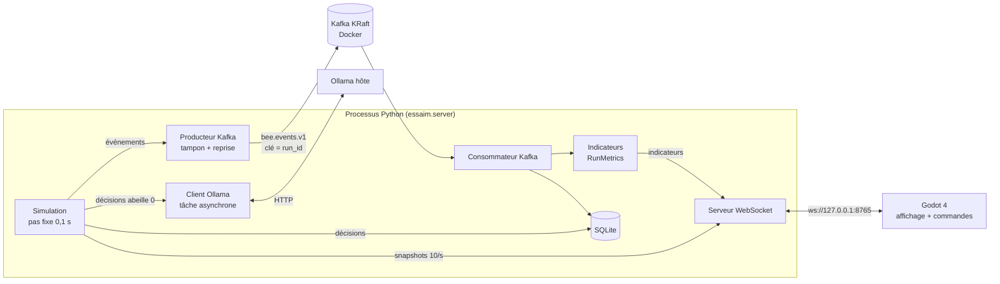

# Essaim MVP : comment un essaim d'abeilles choisit un nid sans chef

Simulation multi-agents : 10 abeilles partent d'une branche, explorent 3 abris, les inspectent et communiquent leurs préférences par la danse. On observe si un choix collectif émerge. Rien n'est imposé : aucun site gagnant n'est fixé et le consensus n'est pas garanti. Il n'y a ni nectar, ni butinage, ni récolte.

> Ce MVP ne couvre pas tout le défi académique : il n'a pas encore de RAG vectoriel ni de protocole expérimental complet.

## Démarrage rapide

```bash
scripts/setup.sh                 # venv Python 3.12 + dépendances épinglées + .env
scripts/start.sh                 # Kafka (Docker, KRaft) puis serveur Python ; options : --mode regles --seed 7
scripts/godot.sh                 # dans un 2e terminal : visualisation Godot
scripts/verify.sh                # vérification complète (tests, Kafka, SQLite, WebSocket, Godot, OpenJev)
```

Arrêt : `Ctrl+C` dans le terminal du serveur, puis `docker compose down` (le volume Kafka est conservé ; `docker compose down -v` l'efface).

## Versions utilisées (vérifiées sur la machine de développement)

| Outil | Version | Où |
|---|---|---|
| Python | 3.12 (venv `.venv`) | hôte |
| aiokafka / websockets / httpx / pytest | 0.12.0 / 15.0.1 / 0.28.1 / 8.4.2 | `backend/requirements.txt` |
| Kafka | `apache/kafka:3.9.1`, mode KRaft, 1 nœud | Docker Compose |
| Godot | 4.7.2 (projet `config_version=5`, renderer Compatibility) | hôte |
| Ollama | 0.34.2 | hôte |
| Modèle | `hf.co/openjev/openjev-GGUF:Q4_K_M` | Ollama (voir [Blocage OpenJev](#blocage-openjev)) |

## Architecture



- **Python contrôle tout** : positions, états, actions et temps. Godot n'exécute aucune simulation, il interpole seulement l'affichage entre deux snapshots.
- **Les snapshots** du monde vont directement de Python à Godot.
- **Les indicateurs** ne viennent que du consommateur Kafka. Ils sont recalculés depuis les événements, jamais lus dans le monde.
- Chaque message porte son `run_id` et son `sim_time`. Godot ignore les indicateurs d'un autre run que celui affiché.

```
backend/essaim/
  config.py     lecture du .env
  world.py      monde, abeilles, règles, pas de temps fixe
  llm.py        prompt [A]/[B]/[C], appel Ollama, validation de la lettre
  metrics.py    soutiens, consensus, stabilité (depuis les événements)
  db.py         SQLite : runs, events, decisions
  server.py     boucle de simulation, Kafka, WebSocket
  check_llm.py  appel réel unique au modèle configuré
backend/tests/  pytest
godot/          projet Godot (main.tscn, main.gd, tests/ws_smoke.gd)
scripts/        setup, start, godot, verify, check_openjev
```

## Simulation

**Monde** (1000 × 600 unités) : une branche au centre et 3 abris.

| Abri | Position | Volume | Sécheresse | Entrée | Score (règle ci-dessous) |
|---|---|---|---|---|---|
| A · Creux du chêne | (840, 120) | 40 L | 0,9 | 14 cm² | 0,957 |
| B · Nichoir | (160, 160) | 32 L | 0,8 | 18 cm² | 0,800 |
| C · Fissure du rocher | (720, 500) | 55 L | 0,6 | 28 cm² | 0,520, le plus proche |

**Règle d'évaluation** (`evaluate_site`), entre 0 et 1 :
`0,5 × volume + 0,3 × sécheresse + 0,2 × entrée`, où
- volume = `max(0, 1 − |V − 40| / 40)`, avec un idéal de 40 L ;
- entrée = `max(0, 1 − |E − 15| / 15)`, avec un idéal de 15 cm².

Un abri inaccessible n'a pas de score.

**Abeilles** : chacune a une position, un état, un profil, une mémoire limitée à 8 souvenirs et une préférence qui peut être nulle.

Les trois profils diffèrent par l'envie d'explorer, la propension à suivre une recommandation, le seuil d'acceptation, la vigueur de danse et la vitesse :
- `eclaireuse` : abeilles 0 à 2 ;
- `prudente` : abeilles 3 à 5 ;
- `suiveuse` : abeilles 6 à 9.

**États :**
- **REPOS** : sur la branche, décision toutes les 2 s ou dès qu'une danse est reçue.
- **EXPLORATION** : marche aléatoire, ou vol dirigé vers un site connu. Un abri est découvert à moins de 50 unités.
- **INSPECTION** : 3 s sur place. C'est le seul moment où l'abeille obtient les propriétés réelles, via `World.inspect()`, qui refuse toute inspection à distance.
- **RETOUR** : vol vers la branche.
- **DANSE** : sur la branche. Durée = `15 s × score × vigueur × 0,6^(danses déjà faites)`. Chaque seconde, chaque abeille au repos sur la branche a 35 % de chances de recevoir la recommandation. Après sa danse, l'abeille retourne contrôler son site.

**Ce qu'une abeille sait :**
- Sa mémoire distingue deux sortes de souvenirs : les **observations** personnelles (issues d'une inspection) et les **informations reçues** (danses, alertes), jamais vérifiées par elle.
- Une préférence ne peut venir que d'une observation personnelle. Une recommandation reçue incite seulement l'abeille à aller vérifier.
- Aucune abeille n'accède aux préférences des autres, aux indicateurs ni aux propriétés cachées. Les règles et le prompt LLM ne lisent que l'abeille elle-même.

**Abri rendu inaccessible** (bouton dans Godot) : les abeilles ne l'apprennent qu'en s'y rendant (observation « INACCESSIBLE »). Celle qui l'a constaté le signale ensuite sur la branche (information reçue). Une abeille qui préférait ce site va vérifier par elle-même avant d'abandonner sa préférence.

**Temps et commandes** :
- pas fixe `SIM_DT` = 0,1 s simulée, à la vitesse de `SIM_SPEED` secondes simulées par seconde réelle ;
- graine `SIM_SEED`. En mode règles, une même graine donne le même déroulé (testé) ;
- commandes pause, reprise et réinitialisation (graine et mode au choix) ;
- fin automatique à `SIM_MAX_TIME`.

**Exemples en mode règles** (600 s simulées, indicateurs calculés depuis les événements) :

| Graine | Soutiens A / B / C (fin) | Indécises | Consensus | Atteint à t (s) | Stabilité |
|---|---|---|---|---|---|
| 1 | 0 / 10 / 0 | 0 | B | 106,2 | 100 % |
| 2 | 7 / 3 / 0 | 0 | B, puis perdu | 125,3 | 2 % |
| 3 | 7 / 3 / 0 | 0 | aucun | — | — |
| 4 | 8 / 1 / 1 | 0 | A | 122,7 | 100 % |
| 42 | 0 / 9 / 1 | 0 | B | 109,3 | 100 % |

L'essaim ne choisit pas toujours le meilleur abri (A). Un engagement précoce sur B, plus facile à trouver, peut l'emporter.

## Ollama / OpenJev

- **Mode `llm`** (par défaut) : **l'abeille 0** décide via Ollama, les 9 autres suivent les règles. **Mode `regles`** : les 10 abeilles suivent les règles, pour comparaison. Le mode se choisit par `SIM_MODE`, `--mode` ou la liste déroulante de Godot.
- **Moments de décision** : le modèle est appelé seulement aux moments de décision, jamais à chaque pas.
  - Sur la branche : rester, explorer, vérifier une recommandation, ou danser au retour.
  - Après une inspection : adopter l'abri, garder sa préférence, ou rester indécise.
- **Prompt** : profil, état, préférence, observations personnelles, informations reçues et actions autorisées sous la forme `[A]`, `[B]`, `[C]`. On demande la lettre seule.
- **Validation** : Python valide la lettre puis applique l'action. Une réponse invalide, un timeout (`OLLAMA_TIMEOUT_S`), une erreur HTTP ou un modèle absent déclenchent un **repli à règles marqué `fallback`**, avec sa cause. Godot l'affiche en rouge et SQLite l'enregistre dans `decisions.error`.
- **Pendant l'appel**, l'abeille 0 reste sur place, mais la simulation et le WebSocket continuent (testé : réponse WebSocket en moins de 0,5 s pendant un appel de 1,5 s).
- **Réponse tardive** : elle est revalidée. Une option devenue impossible est retirée, et une décision issue d'un ancien run (après réinitialisation) est ignorée et journalisée `ignorée`.
- **Journalisation dans `decisions`** : latence, `prompt_tokens`, `completion_tokens`, `context_tokens` (`OLLAMA_NUM_CTX`) et `tokens_available` (contexte moins prompt).

### Blocage OpenJev

`scripts/check_openjev.sh` vérifie la machine **avant** tout téléchargement. Sur la machine de développement, un Mac M4 Pro avec **24 Go de RAM**, le résultat est le suivant :
- le modèle existe sur Hugging Face (`OpenJev-Q4_K_M.gguf`, environ 16,5 Go) ;
- mais sa fiche demande **32 Go de RAM** sur Mac ;
- **le modèle n'a donc pas été téléchargé** et aucun autre modèle ne le remplace.

Le serveur l'annonce au démarrage. L'abeille 0 fonctionne en repli à règles, signalé `fallback (Ollama modèle absent)`.

Sur une machine avec 32 Go ou plus : `scripts/check_openjev.sh --pull`, puis `cd backend && ../.venv/bin/python -m essaim.check_llm` pour un appel réel, également lancé automatiquement par `scripts/verify.sh`.

## Kafka et persistance

- **Broker** : `apache/kafka:3.9.1` en KRaft (broker et contrôleur sur un seul nœud), avec contrôle de santé (`kafka-broker-api-versions.sh`) et volume nommé `kafka-data`. Il est publié uniquement sur `127.0.0.1:9092`.
- **Topic** : `bee.events.v1`, 3 partitions, créé par le service `kafka-init`. La création automatique de topics est désactivée.
- **Clé de partition** : `run_id`. Tous les événements d'un run vont donc dans la même partition, dans l'ordre.
- **Enveloppe** de chaque événement : `schema_version, event_id, run_id, sequence, sim_time, agent_id, event_type, payload`.
- **Types d'événements** :
  - `run_started` et `run_ended` (avec la raison : durée maximale ou réinitialisation) ;
  - `site_discovered`, `site_inspected`, `communication` (danse ou alerte, avec les destinataires) et `preference_changed` (ancienne et nouvelle préférence, source `règles`/`llm`/`fallback`/`observation`) ;
  - `sim_paused`, `sim_resumed` et `site_access_changed` ;
  - `heartbeat`, une fois par seconde simulée, pour que le consommateur mesure les durées de consensus.

**Consommateur** (groupe `bee-metrics`, commit manuel) :
1. Chaque message est inséré dans SQLite avec `INSERT OR IGNORE`. La clé primaire `event_id` et la contrainte `UNIQUE(run_id, sequence)` empêchent tout doublon.
2. Les indicateurs ignorent tout `event_id` déjà vu. Un événement reçu deux fois ne double donc rien (testé).
3. L'offset Kafka n'est validé **qu'après** le commit SQLite (livraison « au moins une fois »).

**SQLite** (`data/essaim.sqlite3`) contient trois tables :
- `runs` : graine, mode, modèle, raison de fin, indicateurs finaux ;
- `events` ;
- `decisions` : toutes les décisions, règles comprises.

### Reconnexion, redémarrage et pannes

- **Kafka tombe pendant un run** :
  - la simulation continue, mais Godot affiche **Kafka : PANNE** ;
  - le producteur garde les événements dans un tampon de 10 000 au maximum. Le nombre d'événements en attente et perdus est visible ;
  - les indicateurs se figent et Godot les affiche « en retard » ;
  - au retour du broker, le tampon est republié dans l'ordre et les indicateurs rattrapent leur retard ;
  - testé : broker arrêté 12 à 15 s, résultat 440 événements pour 440 séquences, aucun trou, aucun doublon, aucune perte.
- **Tampon plein** : les événements en trop sont **comptés comme perdus** et journalisés. Rien n'est caché.
- **Redémarrage du serveur Python** :
  - un **nouveau run** commence ;
  - le consommateur reprend au dernier offset validé, et les messages déjà traités, éventuellement relus, sont ignorés ;
  - si des événements d'un run inconnu en mémoire arrivent, ses indicateurs sont reconstruits depuis SQLite ;
  - un run interrompu par un arrêt brutal reste sans `run_ended` dans `runs`.
- **Godot perd la connexion** : il retente toutes les 2 s. À la reconnexion, le serveur envoie immédiatement un snapshot complet, le statut et les indicateurs du run courant.

## Indicateurs (affichés dans Godot)

- **Soutiens par site** et **abeilles indécises**.
- **Proportion soutenant le site en tête**.
- **Consensus** : au moins `CONSENSUS_MIN_BEES` (8) abeilles sur 10 soutiennent le même site pendant `CONSENSUS_HOLD_S` (10) secondes simulées. C'est un réglage de l'observateur, jamais communiqué aux abeilles. Le **temps d'apparition** est l'instant où le maintien de 10 s est atteint. Un run peut se terminer sans consensus.
- **Stabilité** : part du temps écoulé depuis le premier consensus pendant laquelle ce site reste au-dessus du seuil. S'y ajoute le **nombre de ruptures**.

## Godot

`scripts/godot.sh`, ou ouvrir `godot/project.godot` dans l'éditeur Godot 4 puis F5.

**Affichage :**
- la branche, les 3 abris (barrés s'ils sont inaccessibles) et les abeilles animées (ailes ; frétillement en danse) ;
- la couleur d'une abeille suit sa préférence : A rouge, B bleu, C vert, gris si indécise. L'abeille LLM est cerclée de violet ;
- dans le panneau : statut Python, Kafka et Ollama, run, graine, temps simulé et indicateurs avec le temps simulé de leur calcul.

**Commandes :** Pause, Reprise, Réinitialiser (graine et mode), Bloquer/Ouvrir A, B ou C.

**Clic sur une abeille :** profil, état, préférence, observations personnelles, informations reçues, remplissage de la mémoire, et origine de la dernière décision (`LLM`, `RÈGLES` ou `FALLBACK`, avec latence ou motif du repli).

Variables utiles : `ESSAIM_WS_URL` (par défaut `ws://127.0.0.1:8765`), `ESSAIM_SELECT_BEE=0`, `ESSAIM_SCREENSHOT=/tmp/vue.png` (capture après 6 s puis fermeture).

## Vérification

`scripts/verify.sh` enchaîne les contrôles suivants :
1. Versions des outils.
2. Santé de Kafka et présence du topic.
3. **pytest**, 26 tests :
   - simulation à règles déterministe ;
   - une abeille ne connaît aucun abri qu'elle n'a ni observé, ni découvert, ni reçu ;
   - préférence uniquement après inspection ;
   - inspection à distance refusée ;
   - abri bloqué appris seulement par observation ;
   - doublons sans effet sur les indicateurs ;
   - consensus, rupture et stabilité ;
   - validation de la lettre, fallback, décision d'un ancien run ignorée, faux serveur Ollama (tokens, timeout) ;
   - WebSocket : pause, reprise, réinitialisation, reconnexion avec snapshot complet, réactivité pendant un appel LLM lent ;
   - **aller-retour réel Kafka → SQLite** avec événements republiés et reconstruction après redémarrage.
4. Import Godot et analyse de `main.gd`.
5. Serveur temporaire, puis client Godot headless (`tests/ws_smoke.gd`) : snapshot, pause et reprise acquittées, événements bien présents dans SQLite.
6. Diagnostic OpenJev, et appel réel si le modèle est installé.

Tests Python seuls : `cd backend && ../.venv/bin/python -m pytest -q`. Le test Kafka est ignoré, avec un message, si le broker est arrêté.

## Dépannage

| Symptôme | Cause / solution |
|---|---|
| Godot : « En attente du serveur Python » | Lancer `scripts/start.sh`. Vérifier `WS_PORT` et `ESSAIM_WS_URL`. |
| Kafka : PANNE, « dernier msg il y a N s » | `docker compose ps`, `docker compose logs kafka`, puis `docker compose up -d --wait kafka`. Les événements attendent dans le tampon. |
| Port 9092 déjà utilisé | Changer `KAFKA_HOST_PORT` **et** `KAFKA_BOOTSTRAP` dans `.env`. |
| `GroupCoordinatorNotAvailable` au tout premier lancement | Normal : Kafka crée son topic interne d'offsets. Disparaît en quelques secondes. |
| Ollama : « modèle absent » | Voir [Blocage OpenJev](#blocage-openjev). L'abeille 0 passe en `fallback`, rien n'est remplacé. |
| Ollama : « hors ligne » | Lancer l'application Ollama et vérifier `curl http://localhost:11434/api/tags`. |
| Décisions LLM lentes ou en `timeout` | Augmenter `OLLAMA_TIMEOUT_S`. Chaque cas est enregistré dans `decisions`. |
| Godot : erreur de parse | `godot --headless --path godot --check-only --script res://main.gd` affiche la ligne en cause. |
| Repartir de zéro | `docker compose down -v && rm -rf data/` |

Inspecter la base : `sqlite3 data/essaim.sqlite3 "select source, count(*) from decisions group by source;"`
